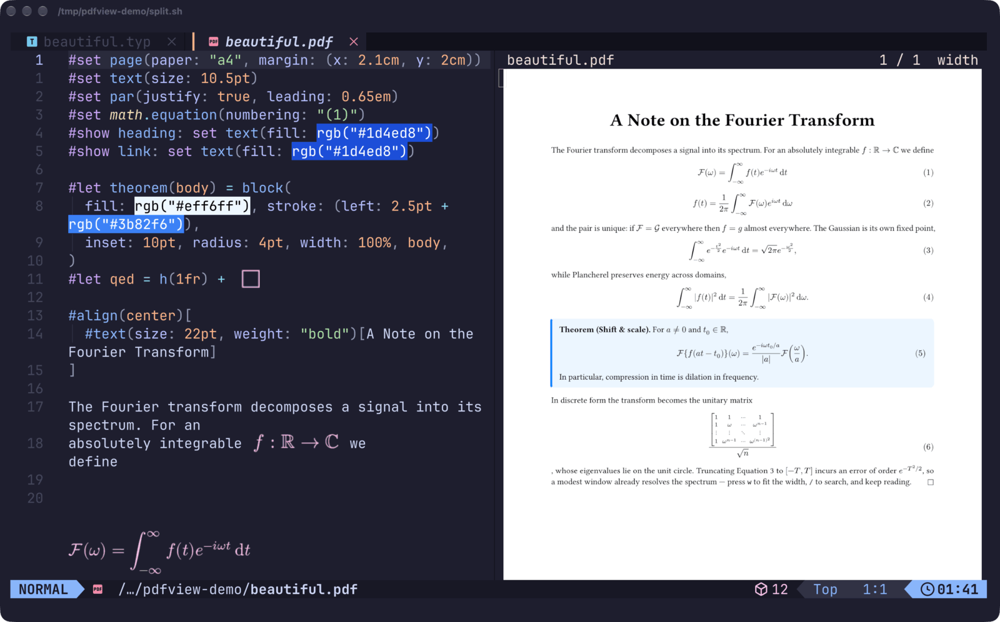

<div align="center">

# pdf-view.nvim

_Read PDFs inside Neovim as normal buffers — sharp, scrollable, searchable._

[](https://github.com/rohit746/pdf-view.nvim/actions/workflows/ci.yml)
[](https://neovim.io)
[](https://mupdf.com)
[](LICENSE)

`nvim paper.pdf` · `:edit paper.pdf` · `:PdfView paper.pdf`

</div>

---

Like [tdf](https://github.com/itsjunetime/tdf), but as a normal buffer: the page is shown as a sharp image fitted to the
window, and `j`/`k` turn the pages. `+` and `-` zoom (then the same keys scroll the page), `w` fits the width, `/`
searches the whole document with every match highlighted, `gO` jumps to a bookmark. When the file changes on disk — a
LaTeX or Typst build, say — the page refreshes by itself.

- Pages are rendered by [MuPDF](https://mupdf.com)'s `mutool` and drawn with the
  [Kitty graphics protocol](https://sw.kovidgoyal.net/kitty/graphics-protocol/) using Unicode placeholders, so the
  image behaves like text: it follows splits, tabs, resizes and works inside tmux.
- No dependency on other plugins, ImageMagick or Ghostscript.
- Opening a PDF never reads its bytes into a buffer, and `:w` can never overwrite it.

<div align="center">



</div>

## Requirements

- Neovim 0.11 or newer, with `termguicolors` (the image id travels in a 24-bit foreground colour).
- `mutool` from MuPDF, built with JavaScript support (the Homebrew `mupdf`, Debian/Ubuntu and Arch `mupdf-tools`
  packages are):
  `brew install mupdf` · `apt install mupdf-tools` · `pacman -S mupdf-tools`
- A terminal with Kitty graphics **and** Unicode placeholder support: [kitty](https://sw.kovidgoyal.net/kitty/) or
  [Ghostty](https://ghostty.org). WezTerm and iTerm2 do not implement placeholders.
- Inside tmux (3.3a or newer): nothing to configure, the plugin runs `tmux set -p allow-passthrough on` for its own
  pane. To manage it yourself, set `tmux_passthrough = false` and add `set -g allow-passthrough on` to `tmux.conf`.

> [!TIP]
> Run `:checkhealth pdf-view` to verify all of this.

## Installation

With [lazy.nvim](https://github.com/folke/lazy.nvim) (and therefore LazyVim). Load it eagerly: the handler that
intercepts `*.pdf` has to exist before Neovim tries to read a PDF given on the command line.

```lua
{
  "rohit746/pdf-view.nvim",
  lazy = false,
  opts = {},
}
```

### LazyVim: let pdf-view own `*.pdf`

LazyVim ships [snacks.nvim](https://github.com/folke/snacks.nvim), whose image module also opens `*.pdf` buffers.
Two handlers on one file draw over each other, so remove `pdf` from snacks' formats:

```lua
{
  "folke/snacks.nvim",
  opts = {
    image = {
      formats = {
        "png", "jpg", "jpeg", "gif", "bmp", "webp", "tiff", "heic", "avif",
        "mp4", "mov", "avi", "mkv", "webm", "icns", -- the defaults, minus "pdf"
      },
    },
  },
}
```

Everything else snacks.image does (markdown images, hover previews) keeps working. `:checkhealth pdf-view` warns if
both are active.

## Usage

```vim
:edit paper.pdf        " or: nvim paper.pdf, :split paper.pdf, :tabedit paper.pdf, <C-^>, :b ...
:PdfView paper.pdf     " same thing, with file completion
```

```lua
require("pdf-view").open("paper.pdf")
```

The viewer is a regular buffer named after the file, so buffer lists, `:bdelete`, session plugins and statuslines work
as usual. Its winbar shows `paper.pdf   3 / 11`; for a statusline use `require("pdf-view").status()` (`3 / 11`, with
`width` and `x1.25` added while fitted to the width or zoomed).

### Keys

All are buffer-local, normal mode, and take a count.

| Keys                         | Action                                                                          |
| ---------------------------- | ------------------------------------------------------------------------------- |
| `j` `<Down>`                 | scroll down; at the bottom edge (or when not zoomed) next page. `5j`: five times |
| `k` `<Up>`                   | scroll up; at the top edge (or when not zoomed) previous page                   |
| `l` `<Right>`                | scroll right; at the right edge (or when not zoomed) next page                  |
| `h` `<Left>`                 | scroll left; at the left edge (or when not zoomed) previous page                |
| `<PageDown>` `<C-f>`         | next page, always (`3<PageDown>`: three pages ahead)                            |
| `<PageUp>` `<BS>` `<C-b>`    | previous page, always                                                           |
| `gg` `<Home>`                | first page; `12gg` goes to page 12                                              |
| `G` `<End>`                  | last page; `12G` goes to page 12                                                |
| `+` `=`                      | zoom in (`3+`: three steps)                                                     |
| `-`                          | zoom out; from a width/height fit, back to the whole page                       |
| `0`                          | fit the whole page to the window                                                |
| `w`                          | fit the page's width to the window                                              |
| `W`                          | fit the page's height to the window                                             |
| `/`                          | search forward: prompts for text, jumps to the first match                      |
| `?`                          | search backward                                                                 |
| `n` `N`                      | next / previous match (`n` repeats the direction of the search; takes a count)  |
| `<Esc>`                      | remove the search highlights                                                    |
| `gO`                         | pick a bookmark from the document's outline and go to its page                  |
| `r`                          | re-render the current page                                                      |
| `q`                          | close the viewer (never quits Neovim)                                           |
| `g?`                         | show this list                                                                  |

> [!NOTE]
> `<Space>` is deliberately unbound so `<leader>` mappings keep working.

### Zoom

Zoom 1 is the whole page fitted to the window; `+` makes it 25% larger per step, up to 8×. Zooming keeps whatever
is in the middle of the window in the middle. Once the page is larger than the window, a movement key scrolls it if it
can, and turns the page when it cannot: scroll down past the bottom and you land at the top of the next page, scroll up
past the top and you land at the bottom of the previous one. Without zoom nothing can scroll, so `j`/`k`/`h`/`l` are
plain page turns. The zoom level stays when you turn pages or the file reloads, and the winbar shows it (`125%`).

### Fit width and height

A portrait page in a wide window is fitted by height and leaves the sides empty. `w` makes the page exactly as wide as
the window instead, starting at its top; `j`/`k` then read down the page and turn to the next one at the end, so a
document reads like a scrolling column. `W` is the same for height, useful for landscape pages in a tall window. The
mode applies to every page (each page is fitted by its own size), survives resizes, and combines with zoom: `+` in width
mode shows `width 125%` in the winbar. `-` steps back out to the fitted size first and to the whole page after that;
`0` goes straight to the whole page.

### Search

`/` prompts for text (through `vim.ui.input`, so you get the same prompt as the rest of your config), searches the whole
document ignoring case, and jumps to the first match on or after the current page. Every match on the page is
highlighted, the current one in a different colour, and the winbar shows `/needle 3/17`. `n` and `N` move between
matches across pages, wrapping around the document; zoomed or width-fitted views scroll to a match only if it is not
already on screen. `?` searches backward, and `n` then keeps going backward. `<Esc>` removes the highlights. The search
runs again by itself when the file changes.

Highlights are drawn into the page image, multiplied onto it so text stays readable (on MuPDF older than 1.27 they are
a translucent fill instead, which dulls the text under a match a little). The colours are configurable
(`highlight`), and at most `search_limit` matches are collected (the winbar shows `17/5000+` when that cuts the list).

### Outline

`gO` lists the document's bookmarks, indented by depth, through `vim.ui.select` (a picker such as snacks.nvim's if you
use one) and jumps to the chosen page. Documents without bookmarks say so.

## Configuration

`setup()` is optional. These are the defaults:

```lua
require("pdf-view").setup({
  auto_open = true,        -- take over *.pdf buffers (:edit, nvim file.pdf, ...)
  live_reload = true,      -- re-render when the file changes on disk
  reload_delay = 200,      -- ms the file must stay quiet before reloading
  winbar = true,           -- "<file>   <page> / <pages>" in the window's winbar
  hide_cursor = true,      -- hide the cursor while a viewer is focused (it would sit on top of the page)
  mutool = "mutool",       -- executable
  transmission = "auto",   -- "file": the terminal reads the PNG itself; "direct": send the bytes (SSH). auto = SSH-aware
  tmux_passthrough = true, -- run `tmux set -p allow-passthrough on` for this pane
  force = false,           -- skip terminal detection
  max_pixels = 4096,       -- cap for either side of a fitted page (zoomed views are window-sized anyway)
  zoom_step = 1.25,        -- factor of one zoom step
  max_zoom = 8,            -- largest zoom, relative to the fitted page
  pan_step = 0.2,          -- one scroll key moves this fraction of the window
  search_limit = 5000,     -- stop collecting matches after this many
  highlight = { match = "#ffe14d", current = "#ff8c1a" }, -- multiplied onto search matches
  cell_size = nil,         -- { width, height } in px, only if your terminal does not report its pixel size
  keymaps = {              -- a list per action; `false` for no mappings at all
    down = { "j", "<Down>" },
    up = { "k", "<Up>" },
    right = { "l", "<Right>" },
    left = { "h", "<Left>" },
    next = { "<PageDown>", "<C-f>" },
    prev = { "<PageUp>", "<BS>", "<C-b>" },
    first = { "gg", "<Home>" },
    last = { "G", "<End>" },
    zoom_in = { "+", "=" },
    zoom_out = { "-" },
    zoom_reset = { "0" },
    fit_width = { "w" },
    fit_height = { "W" },
    search = { "/" },
    search_back = { "?" },
    search_next = { "n" },
    search_prev = { "N" },
    search_clear = { "<Esc>" },
    outline = { "gO" },
    reload = { "r" },
    close = { "q" },
    help = { "g?" },
  },
})
```

Unknown or mistyped options raise an error immediately. A keymap list replaces the default list for that action.

With `auto_open = false` only `:PdfView` and `require("pdf-view").open()` open PDFs.

## Live reload

The directory of every open PDF is watched. Once the file has been quiet for `reload_delay` ms it is re-read and the
current page is re-rendered, staying on the same page number. A file that is mid-write (a compiler still emitting it)
is retried for a few seconds while the previous page stays on screen.

## How it works

1. `mutool run` reports the page count and the exact size of the page (rotation, crop box and `UserUnit` applied).
2. The page is fitted to the window in whole terminal cells and rendered by `mutool draw` to a PNG of exactly
   `cols × cell_width` by `rows × cell_height` pixels, so the terminal maps pixels to cells one to one.
3. The PNG is uploaded to the terminal (`a=t`) and a virtual placement is created (`a=p,U=1`).
4. The buffer is filled with `U+10EEEE` placeholder cells whose foreground colour is the image id; the terminal paints
   the image over them.

When zoomed, step 2 renders only the rectangle of the enlarged page that is on screen (a small script run by
`mutool run`), so a window-sized PNG is all that is ever drawn and uploaded, however deep the zoom, and scrolling costs
the same as turning a page.

Search runs `mutool run` over the whole document once per query and keeps the match rectangles; highlights are
drawn by the same clip script, which then also renders unzoomed pages whenever the page has matches. The outline is read
the same way and cached until the file changes.

Two image ids are used per viewer alternately, so changing page never shows a blank frame. Rendered pages and
scroll positions are cached.

## Troubleshooting

| Symptom                                          | Fix                                                                                                   |
| ------------------------------------------------ | ----------------------------------------------------------------------------------------------------- |
| The buffer shows an error instead of a page      | Read it; `:checkhealth pdf-view` explains most causes.                                                |
| Garbage characters instead of an image           | The terminal lacks Unicode placeholders, or tmux blocks passthrough (see Requirements).               |
| Image is blurry                                  | The terminal did not report its pixel size; set `cell_size = { width, height }`.                      |
| Image vanished after detaching/re-attaching tmux | Press `r`: the new terminal never received the image.                                                 |
| The PDF opens as binary text                     | The plugin loaded too late. Use `lazy = false` and make sure nothing else owns `BufReadCmd *.pdf`.    |
| Over SSH nothing appears                         | Use a terminal that supports the protocol; images are then sent inline (`transmission = "direct"`).   |

## Limitations

- Terminals: kitty and Ghostty (Unicode placeholders are required; WezTerm and iTerm2 do not implement them).
- Search is literal and ignores case; there is no regex or case-sensitive mode. It only finds text that is in the PDF,
  so scanned pages without an OCR layer have no matches.
- A buffer shown in two windows has one layout, computed for the window you are in; the other shows the same cells.
- Only `*.pdf` files are opened automatically.

## Compatibility

Developed against Neovim 0.12, MuPDF 1.28 and tmux 3.7. The test suite passes on Neovim 0.11.0 and 0.12 and on MuPDF
1.23.10, 1.24, 1.25, 1.26, 1.27 and 1.28 (older MuPDF is untested), and CI runs it on Linux and macOS.
`:checkhealth pdf-view` tells you whether your `mutool` supports everything the plugin needs.

## Development

```
lua/pdf-view/
  init.lua        setup(), the :PdfView command, the *.pdf handler
  config.lua      defaults and validation
  viewer.lua      a PDF buffer's lifecycle: attach, open, file watching, cleanup
  session.lua     per-buffer state and the helpers that touch windows, the winbar and the render cache
  render.lua      showing a page: mutool -> PNG -> terminal -> placeholder cells, latest request wins
  actions.lua     what the keys do: page turns, scrolling, zoom, fit modes, search, outline
  cursor.lua      hiding the cursor while a viewer is focused
  layout.lua      fitting a page into whole terminal cells; zoomed viewports (pure)
  search.lua      search results: parsing, stepping, highlight strings (pure)
  mupdf.lua       async wrapper around mutool
  kitty.lua       graphics protocol encoding, tmux passthrough
  placeholder.lua Unicode placeholder text
  terminal.lua    terminal detection, cell size, tmux
  watch.lua       file watching
  health.lua      :checkhealth pdf-view
scripts/          JavaScript run by `mutool run`: page geometry, clipped rendering, search, outline
tests/            headless suite (`make test`)
```

```sh
make test      # headless suite: protocol encoding, layout, mutool, and the whole viewer with a stubbed UI
make format    # stylua
```

## License

MIT
