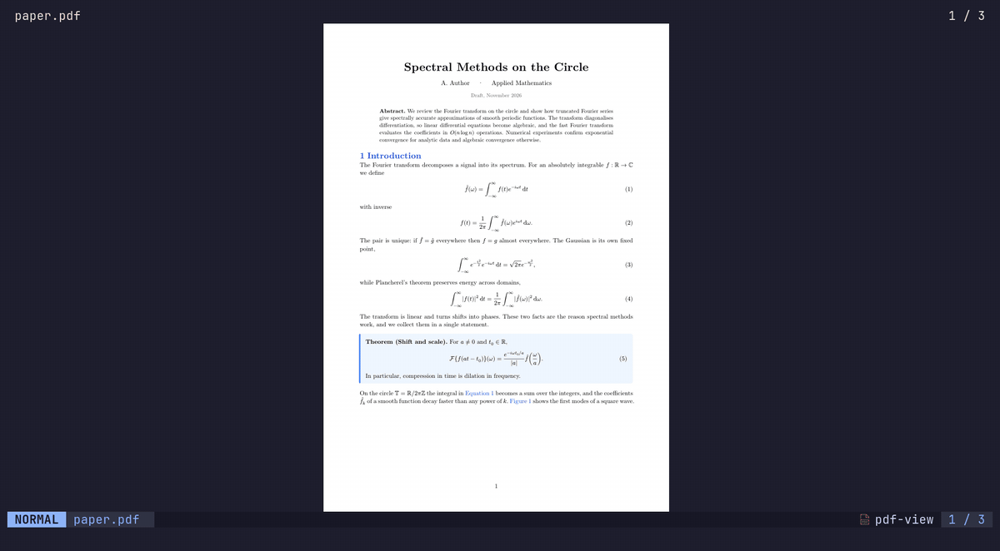
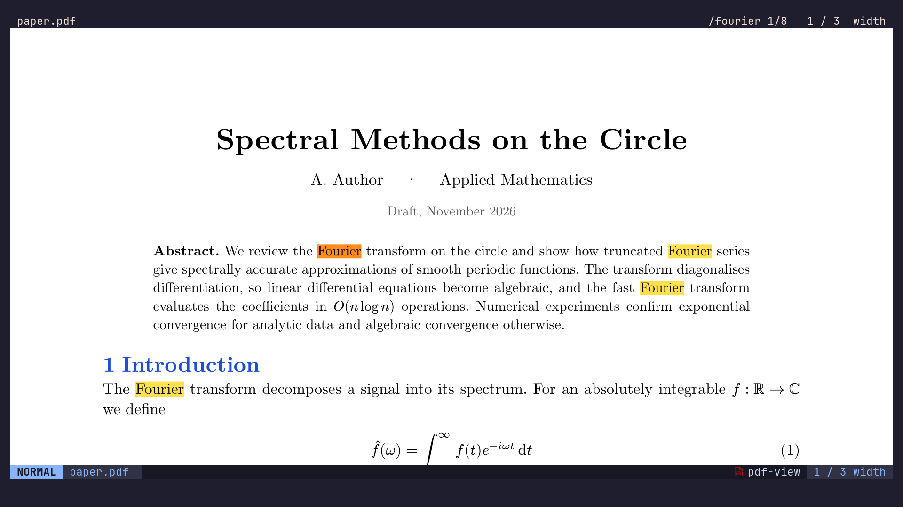
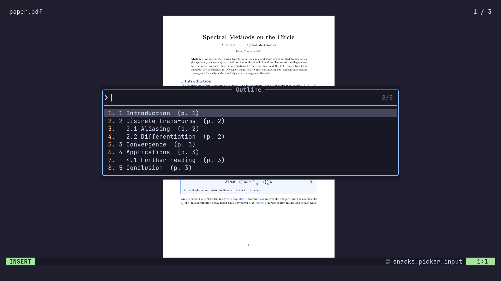
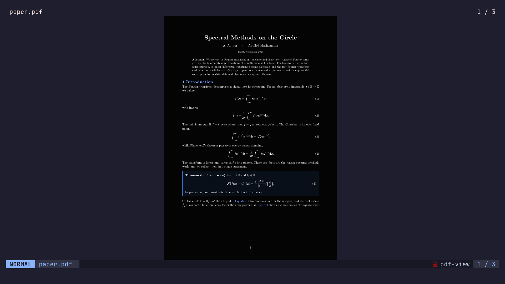
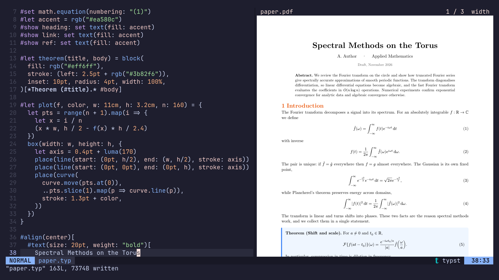

<div align="center">

# pdf-view.nvim

_Read PDFs inside Neovim as normal buffers — sharp, scrollable, searchable._

[](https://github.com/rohit746/pdf-view.nvim/actions/workflows/ci.yml)
[](https://neovim.io)
[](https://mupdf.com)
[](LICENSE)

`nvim paper.pdf` · `:edit paper.pdf` · `:PdfView paper.pdf`

</div>

---

Like [tdf](https://github.com/itsjunetime/tdf), but as a normal buffer: the page is shown as a sharp image fitted to the
window, and `j`/`k` turn the pages. `+` and `-` zoom (then the same keys scroll the page), `w` fits the width, `/`
searches the whole document with every match highlighted, `gO` jumps to a bookmark. When the file changes on disk — a
LaTeX or Typst build, say — the page refreshes by itself.

- Pages are rendered by [MuPDF](https://mupdf.com)'s `mutool` and drawn with the
  [Kitty graphics protocol](https://sw.kovidgoyal.net/kitty/graphics-protocol/) using Unicode placeholders, so the
  image behaves like text: it follows splits, tabs, resizes and works inside tmux. zellij, WezTerm and Konsole have no
  placeholders, so there the page is placed at its window's position instead ([Positioned placements](#positioned-placements)).
- No dependency on other plugins, ImageMagick or Ghostscript.
- Opening a PDF never reads its bytes into a buffer, and `:w` can never overwrite it. `:w {file}` saves a copy.

<div align="center">



</div>

## Requirements

- Neovim 0.11 or newer, with `termguicolors` (the image id travels in a 24-bit foreground colour; zellij, WezTerm and
  Konsole do not need it).
- `mutool` from MuPDF, built with JavaScript support (the Homebrew `mupdf`, Debian/Ubuntu and Arch `mupdf-tools`
  packages are):
  `brew install mupdf` · `apt install mupdf-tools` · `pacman -S mupdf-tools`
- A terminal with the Kitty graphics protocol: [kitty](https://sw.kovidgoyal.net/kitty/) or
  [Ghostty](https://ghostty.org), which also have its Unicode placeholders, or [WezTerm](https://wezterm.org) or
  [Konsole](https://konsole.kde.org), which do not ([Positioned placements](#positioned-placements)). WezTerm needs
  `config.enable_kitty_graphics = true` in `wezterm.lua`. iTerm2 has no Kitty graphics.
- Inside tmux (3.3a or newer): the plugin runs `tmux set -p allow-passthrough on` for its own pane. To manage it
  yourself, set `tmux_passthrough = false` and add `set -g allow-passthrough on` to `tmux.conf`. tmux must also pass
  24-bit colour on: if `:checkhealth pdf-view` says it doesn't, add `set -as terminal-features ',xterm-kitty:RGB'`
  (with your outer `$TERM`) to `tmux.conf`.
- Inside zellij (0.45 or newer): nothing to configure. See [zellij](#zellij) for how it differs.
- WezTerm or Konsole inside tmux: also `set -g focus-events on`, so that a page leaves the screen when you switch to
  another tmux window.

> [!TIP]
> Run `:checkhealth pdf-view` to verify all of this.

## Installation

With [lazy.nvim](https://github.com/folke/lazy.nvim) (and therefore LazyVim). Load it eagerly: the handler that
intercepts `*.pdf` has to exist before Neovim tries to read a PDF given on the command line.

```lua
{
  "rohit746/pdf-view.nvim",
  lazy = false,
  opts = {},
}
```

### LazyVim: let pdf-view own `*.pdf`

LazyVim ships [snacks.nvim](https://github.com/folke/snacks.nvim), whose image module also opens `*.pdf` buffers.
Two handlers on one file draw over each other, so remove `pdf` from snacks' formats:

```lua
{
  "folke/snacks.nvim",
  opts = {
    image = {
      formats = {
        "png", "jpg", "jpeg", "gif", "bmp", "webp", "tiff", "heic", "avif",
        "mp4", "mov", "avi", "mkv", "webm", "icns", -- the defaults, minus "pdf"
      },
    },
  },
}
```

Everything else snacks.image does (markdown images, hover previews) keeps working. `:checkhealth pdf-view` warns if
both are active.

## Usage

```vim
:edit paper.pdf        " or: nvim paper.pdf, :split paper.pdf, :tabedit paper.pdf, <C-^>, :b ...
:PdfView paper.pdf     " same thing, with file completion
```

```lua
require("pdf-view").open("paper.pdf")
```

The viewer is a regular buffer named after the file, so buffer lists, `:bdelete`, session plugins and statuslines work
as usual. Its winbar shows `paper.pdf   3 / 11`; for a statusline use `require("pdf-view").status()` (`3 / 11`, with
`width` and `x1.25` added while fitted to the width or zoomed).

A PDF opens where you left it: the page, fit and zoom of the last 100 PDFs are kept in
`stdpath("state")/pdf-view/positions.json`, so this survives restarting Neovim. `remember_position = false` turns it
off.

A password-protected PDF asks for its password when it opens, and the password is kept until Neovim exits, so
reopening the PDF does not ask again. It reaches `mutool` on standard input, never on a command line where `ps` would
show it. Cancel the prompt to leave the PDF locked, and `:edit` to be asked again.

### Keys

All are buffer-local and normal mode. The keys that move, zoom or step between matches take a count.

| Keys                         | Action                                                                          |
| ---------------------------- | ------------------------------------------------------------------------------- |
| `j` `<Down>`                 | scroll down; at the bottom edge (or when not zoomed) next page. `5j`: five times |
| `k` `<Up>`                   | scroll up; at the top edge (or when not zoomed) previous page                   |
| `l` `<Right>`                | scroll right; at the right edge (or when not zoomed) next page                  |
| `h` `<Left>`                 | scroll left; at the left edge (or when not zoomed) previous page                |
| mouse wheel                  | like `j` `k` `l` `h`, while a viewer has focus: moves the viewer under the mouse |
| `<PageDown>` `<C-f>`         | next page, always (`3<PageDown>`: three pages ahead)                            |
| `<PageUp>` `<BS>` `<C-b>`    | previous page, always                                                           |
| `gg` `<Home>`                | first page; `12gg` goes to page 12                                              |
| `G` `<End>`                  | last page; `12G` goes to page 12                                                |
| `+` `=`                      | zoom in (`3+`: three steps)                                                     |
| `-`                          | zoom out; from a width/height/content fit, back to the whole page               |
| `0`                          | fit the whole page to the window                                                |
| `w`                          | fit the page's width to the window                                              |
| `W`                          | fit the page's height to the window                                             |
| `c`                          | fit the page's content to the window, cropping the margins                      |
| `/`                          | search forward: prompts for text, jumps to the first match                      |
| `?`                          | search backward                                                                 |
| `n` `N`                      | next / previous match (`n` repeats the direction of the search; takes a count)  |
| `<Esc>`                      | remove the search highlights                                                    |
| `gO`                         | pick a bookmark from the document's outline and go to its page                  |
| `f`                          | pick a link on the page: go to its page, or open its address                    |
| `y`                          | yank the page's text, linewise (`"+y`: to the clipboard)                        |
| `t`                          | show the page's text in a scratch split                                         |
| `<C-o>` `<C-i>` `<Tab>`      | back / forward through the jump list (takes a count)                            |
| `m{a-z}`                     | mark the page, with its fit, zoom and view                                      |
| `'{a-z}` `` `{a-z} ``        | go to a mark; `''` goes back to where the latest jump started                   |
| `i`                          | recolour the pages (dark mode), or stop; see [Dark mode](#dark-mode)            |
| `r`                          | re-render the current page                                                      |
| `q`                          | close the viewer (never quits Neovim)                                           |
| `g?`                         | show this list                                                                  |

> [!NOTE]
> `<Space>` is deliberately unbound so `<leader>` mappings keep working.

### Zoom

Zoom 1 is the whole page fitted to the window; `+` makes it 25% larger per step, up to 8×. Zooming keeps whatever
is in the middle of the window in the middle. Once the page is larger than the window, a movement key scrolls it if it
can, and turns the page when it cannot: scroll down past the bottom and you land at the top of the next page, scroll up
past the top and you land at the bottom of the previous one. Without zoom nothing can scroll, so `j`/`k`/`h`/`l` are
plain page turns. The zoom level stays when you turn pages or the file reloads, and the winbar shows it (`125%`).

### Fit width and height

A portrait page in a wide window is fitted by height and leaves the sides empty. `w` makes the page exactly as wide as
the window instead, starting at its top; `j`/`k` then read down the page and turn to the next one at the end, so a
document reads like a scrolling column. `W` is the same for height, useful for landscape pages in a tall window. The
mode applies to every page (each page is fitted by its own size), survives resizes, and combines with zoom: `+` in width
mode shows `width 125%` in the winbar. `-` steps back out to the fitted size first and to the whole page after that;
`0` goes straight to the whole page.

Papers often have wide margins. `c` fits the part of the page that has something on it, plus a few points of paper,
so the text is as large as the window allows. Everything that is not white counts as content: text, images and
figures. Each page is cropped to its own content, which is found the first time a page is shown in this mode (one
extra render of the page) and remembered until the file changes. Zoom scrolls over the content only, leaving the
margins out. A page with a coloured background has no margins to crop, so it is shown whole.

### Search

`/` prompts for text (through `vim.ui.input`, so you get the same prompt as the rest of your config), searches the whole
document ignoring case, and jumps to the first match on or after the current page. Every match on the page is
highlighted, the current one in a different colour, and the winbar shows `/needle 3/17` (`/needle searching…` while
the search runs). `n` and `N` move between matches across pages, wrapping around the document; zoomed or width-fitted
views scroll to a match only if it is not already on screen, and `+` on a fitted page zooms in towards the current
match. `?` searches backward, and `n` then keeps going backward. `<Esc>` removes the highlights. The search runs again
by itself when the file changes.

<div align="center">



</div>

Searches go into Vim's search history (`:history /`). An empty answer to the prompt searches again for the last text
searched in that viewer, as `/<CR>` does in Vim.

Highlights are drawn into the page image, multiplied onto it so text stays readable (on MuPDF older than 1.27 they are
a translucent fill instead, which dulls the text under a match a little). The colours are configurable
(`highlight`), and at most `search_limit` matches are collected (the winbar shows `17/5000+` when that cuts the list).

### Outline

`gO` lists the document's bookmarks, indented by depth, through `vim.ui.select` (a picker such as snacks.nvim's if you
use one) and jumps to the chosen page. Documents without bookmarks say so.

<div align="center">



</div>

### Links

`f` lists the links on the page on screen, top to bottom, with the text under each and where it leads, through
`vim.ui.select`. A link to a page of the document goes there (a jump, so `<C-o>` comes back); a web address or an e-mail
opens with `vim.ui.open()`. A page without links says so.

### Page text

`y` yanks the text of the page on screen, a line per line of text and an empty line between blocks, into the register
given (`"+y` copies it to the clipboard, `"ay` into register `a`), linewise. `t` shows the same text in a scratch buffer
in a vertical split next to the viewer, to quote from or to search with Neovim's own tools. Each document has one such
buffer, named after the page it holds: `t` on another page fills it with that page and goes back to its split. The text
of an EPUB, FB2 or MOBI page follows its layout. A scanned page has no text to copy, and says so.

### Dark mode

`i` recolours the pages, and `i` again shows them as they are. `recolor` says how, and whether the pages start out
recoloured:

- `"invert"` inverts the brightness but keeps the hues: white paper turns black and black text white, while a red
  figure stays red. `i` recolours this way when `recolor` is `"off"`.
- `"colorscheme"` draws the pages in the colours of the `Normal` highlight group, black in its text colour and white in
  its background, so the page blends in with the colorscheme. The pages are drawn again when the colorscheme changes.

Search highlights are recoloured with the page.

<div align="center">



</div>

### Jumps and marks

`gg`, `G`, `{count}G`, outline picks, search matches (`/`, `?`, `n`, `N`) and marks are jumps: each viewer keeps a jump
list of where they started, as Vim does for lines. `<C-o>` goes back through it and `<C-i>` (or `<Tab>`) forward, and
`''` swaps with the position before the latest jump. Page turns and scrolling are not jumps.

`m{a-z}` marks where the viewer is: the page, its fit, zoom and the centre of the view. `'{a-z}` or `` `{a-z} `` goes
back to it, as it was. Marks and the jump list belong to the viewer, and they stay through `:edit`.

## Configuration

`setup()` is optional. These are the defaults:

```lua
require("pdf-view").setup({
  auto_open = true,        -- take over *.pdf buffers (:edit, nvim file.pdf, ...)
  extensions = { "pdf", "cbz", "xps", "epub", "fb2", "mobi" }, -- the files auto_open and :PdfView take, in any case
  live_reload = true,      -- re-render when the file changes on disk
  reload_delay = 200,      -- ms the file must stay quiet before reloading
  winbar = true,           -- "<file>   <page> / <pages>" in the window's winbar
  hide_cursor = true,      -- hide the cursor while a viewer is focused (it would sit on top of the page)
  remember_position = true, -- reopen a PDF at its last page, fit and zoom, also after restarting Neovim
  mutool = "mutool",       -- executable
  transmission = "auto",   -- "file": the terminal reads the PNG itself; "direct": send the bytes (SSH). auto = SSH-aware
  tmux_passthrough = true, -- run `tmux set -p allow-passthrough on` for this pane
  placement = "auto",      -- "placeholders"; "positioned": at the window's position. auto = positioned in zellij,
                           -- WezTerm and Konsole
  force = false,           -- skip terminal detection
  max_pixels = 4096,       -- cap for either side of a fitted page (zoomed views are window-sized anyway)
  zoom_step = 1.25,        -- factor of one zoom step
  max_zoom = 8,            -- largest zoom, relative to the fitted page
  pan_step = 0.2,          -- one scroll key moves this fraction of the window
  search_limit = 5000,     -- stop collecting matches after this many
  text_scale = 1,          -- text size of EPUB, FB2 and MOBI books, relative to the terminal's
  highlight = { match = "#ffe14d", current = "#ff8c1a" }, -- multiplied onto search matches
  recolor = "off",         -- "invert": dark pages, hues kept; "colorscheme": in the Normal colours. `i` toggles it
  cell_size = nil,         -- { width, height } in px, only if your terminal does not report its pixel size
  keymaps = {              -- a list per action; `false` for no mappings at all
    down = { "j", "<Down>" },
    up = { "k", "<Up>" },
    right = { "l", "<Right>" },
    left = { "h", "<Left>" },
    scroll_down = { "<ScrollWheelDown>" },   -- the wheel; `{}` leaves it to Neovim
    scroll_up = { "<ScrollWheelUp>" },
    scroll_right = { "<ScrollWheelRight>" },
    scroll_left = { "<ScrollWheelLeft>" },
    next = { "<PageDown>", "<C-f>" },
    prev = { "<PageUp>", "<BS>", "<C-b>" },
    first = { "gg", "<Home>" },
    last = { "G", "<End>" },
    zoom_in = { "+", "=" },
    zoom_out = { "-" },
    zoom_reset = { "0" },
    fit_width = { "w" },
    fit_height = { "W" },
    fit_content = { "c" },
    search = { "/" },
    search_back = { "?" },
    search_next = { "n" },
    search_prev = { "N" },
    search_clear = { "<Esc>" },
    outline = { "gO" },
    follow_link = { "f" },
    yank_text = { "y" },
    show_text = { "t" },
    jump_back = { "<C-o>" },
    jump_forward = { "<C-i>", "<Tab>" },
    mark = { "m" },       -- then a to z
    goto_mark = { "'", "`" }, -- then a to z, or ' for the latest jump
    recolor = { "i" },
    reload = { "r" },
    close = { "q" },
    help = { "g?" },
  },
})
```

Unknown or mistyped options raise an error immediately. A keymap list replaces the default list for that action.

With `auto_open = false` only `:PdfView` and `require("pdf-view").open()` open PDFs. With it on, `:read` of these files
is refused, since it would insert the file's bytes: use `:PdfView` to open them.

Comic book archives (`.cbz`) and XPS documents open like PDFs, since MuPDF reads them too. `require("pdf-view").open()`
and `:PdfView {file}` take any file MuPDF can open, whatever its extension.

E-books (EPUB, FB2, MOBI) have no pages of their own: they are laid out on pages as large as the window, with text
about the size of the terminal's (`text_scale = 1.5` makes it half as large again). When the window changes size the
book is laid out again and the viewer stays at the same point of the text. Page numbers change with the layout, so
marks and the jump list, which remember page numbers, may point elsewhere afterwards.

## Live reload

The directory of every open PDF is watched. Once the file has been quiet for `reload_delay` ms it is re-read and the
current page is re-rendered, staying on the same page number. A file that is mid-write (a compiler still emitting it)
is retried for a few seconds while the previous page stays on screen. A PDF opened through a symbolic link is followed
to the file the link points to. `:edit` re-reads the file by hand and stays on the same page too.

<div align="center">



</div>

On NFS, SMB, sshfs and WSL's `/mnt/c` (detected on Linux), and wherever the directory cannot be watched, the file is
checked for changes every 500 ms instead. If even that cannot be set up, a notice says live reload is off.

## Positioned placements

WezTerm and Konsole implement the Kitty graphics protocol, but not its Unicode placeholders, and neither does zellij
(below). There the buffer is left blank and the page is placed at the screen position of its window instead. The
plugin keeps the image in step with the screen: it is cut around floating windows and the popup menu that cover it,
taken away while its window is hidden or in another tab page, and put back after Neovim redraws the window.

- The terminal is asked once whether it has Kitty graphics. WezTerm only answers with
  `config.enable_kitty_graphics = true` in `wezterm.lua`; without it the viewer says so instead of staying blank.
- Konsole draws an image under the text only where a cell has the terminal's own background, which Neovim never
  leaves, so there the page is drawn over the text. Konsole cannot read image files, so pages are sent as bytes.
- When a PDF is shown in several windows of one tab page, only one of them shows the page.
- Inside tmux the page is placed on the outer terminal, at the position of Neovim's pane. tmux does not know about it,
  so it is taken away when Neovim's tmux window is left, which Neovim only learns with `set -g focus-events on`.

Another terminal with Kitty graphics but without placeholders can be tried with `placement = "positioned"`: it is
asked whether it has Kitty graphics, and pages are shown if it answers.

## zellij

zellij 0.45 implements the Kitty graphics protocol itself, but not its Unicode placeholders. Inside zellij (detected
by `$ZELLIJ`) the buffer is left blank and the page is placed at the screen position of its window instead. The plugin
then keeps the image in step with the screen:

- It is cut around floating windows and the popup menu that cover it.
- It is taken away while its window is hidden or in another tab page, and put back after Neovim redraws the window.
- zellij forgets an image once it has been scrolled or cleared off its screen (by a long message, or a suspended
  Neovim), and the plugin sends the page again. Neovim 0.12 reads zellij's reply that the image is gone. Neovim 0.11
  cannot read such replies, so there any message that scrolled the screen counts as having dropped the page.

Compared with kitty or Ghostty on their own:

- Turning pages is slower: zellij passes every image on to the terminal as raw pixels, about ten times the size of
  the PNG ([zellij#5596](https://github.com/zellij-org/zellij/issues/5596), fixed in zellij's main branch).
- When a PDF is shown in several windows of one tab page, only one of them shows the page.
- The page is drawn under the text, so text the plugin does not cut the page around shows on top of it.
- In zellij 0.45.1 the page is sent again whenever a float over it moves or changes size. This works around zellij
  drawing the wrong part of a cropped image.

Set `placement = "placeholders"` once your zellij supports Unicode placeholders
([zellij#5531](https://github.com/zellij-org/zellij/pull/5531)).

## How it works

1. A `mutool run` worker, one per open PDF, reports the page count and the exact size of the page (rotation, crop box
   and `UserUnit` applied). It keeps the document open between requests, so a page turn does not start mutool and
   parse the document again; it is restarted when the file changes on disk.
2. The page is fitted to the window in whole terminal cells and rendered by the worker to a PNG of exactly
   `cols × cell_width` by `rows × cell_height` pixels, so the terminal maps pixels to cells one to one.
3. The PNG is uploaded to the terminal (`a=t`) and a virtual placement is created (`a=p,U=1`).
4. The buffer is filled with `U+10EEEE` placeholder cells whose foreground colour is the image id; the terminal paints
   the image over them.

In zellij, WezTerm and Konsole, steps 3 and 4 differ. The buffer stays blank, and the image is placed (`a=p`) at the
screen position of the window, under the text, after moving the cursor there; see
[Positioned placements](#positioned-placements).

When zoomed, step 2 renders only the rectangle of the enlarged page that is on screen, so a window-sized PNG is all
that is ever drawn and uploaded, however deep the zoom, and scrolling costs the same as turning a page.

Search runs `mutool run` over the whole document once per query and keeps the match rectangles; the worker draws the
highlights onto the pages that have matches. The outline is read the same way and cached until the file changes.

Once a page is on screen, the next and the previous page are rendered in the background, so turning to them shows
them at once. Rendered pages and scroll positions are cached. Each viewer has four image ids, and a new page goes to
one that is not on screen, so changing page never shows a blank frame. The terminal keeps the last pages shown under
their ids, and turning back to one of them only places it again instead of uploading the PNG (which over SSH means
sending all of its bytes). In zellij, which forgets an image once nothing shows it, every page is uploaded.

## Development

```
lua/pdf-view/
  init.lua        setup(), the :PdfView command, the *.pdf (and *.cbz, ...) handler
  config.lua      defaults and validation
  viewer.lua      a PDF buffer's lifecycle: attach, open, file watching, cleanup
  session.lua     per-buffer state and the helpers that touch windows, the winbar and the render cache
  render.lua      showing a page: mutool -> PNG -> terminal -> placeholder cells, latest request wins
  actions.lua     what the keys do: page turns, scrolling, zoom, fit modes, search, outline, links, page text
  cursor.lua      hiding the cursor while a viewer is focused
  layout.lua      fitting a page into whole terminal cells; zoomed viewports (pure)
  search.lua      search results: parsing, stepping, highlight strings (pure)
  mupdf.lua       async wrapper around mutool, and the worker that keeps a document open
  kitty.lua       graphics protocol encoding, tmux passthrough
  placeholder.lua Unicode placeholder text
  positioned.lua  zellij, WezTerm, Konsole: the page placed at its window's position, kept in step with floats and redraws
  terminal.lua    terminal detection, cell size, tmux
  watch.lua       file watching
  health.lua      :checkhealth pdf-view
scripts/          JavaScript run by `mutool run`: the worker (page geometry, rendering, page text, links), search, outline
tests/            headless suite (`make test`)
```

```sh
make test      # headless suite: protocol encoding, layout, mutool, and the whole viewer with a stubbed UI
make typecheck # lua-language-server --check, with the types of Neovim's runtime
make lint      # selene
make format    # stylua (2.6.0, as in CI)
```

## License

MIT
